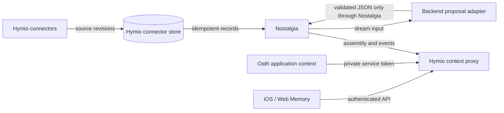

# Application architecture

Hymio is a modular application monorepo with independent runtimes. Clients call authenticated
product APIs. Hymio owns product state and policy, Oath owns task/Agent execution, and Nostalgia
owns personal-context state.

## One request across the system

<SystemArchitecture />

For a normal message:

1. Web, Desktop or iOS attaches its product credential and stable client identity.
2. Backend verifies the account, model/window choice and attachment ownership.
3. Oath durably accepts input, claims a bounded step, builds the request and calls the model.
4. Tool calls return through Hymio's authenticated product APIs; Oath still owns the tool lifecycle.
5. Output becomes durable events. Each client saves and acknowledges its own cursor.

For personal-context work, Hymio asks Nostalgia for stable `_core` and `_index` content during the
application-context build. The Agent can call `recall` for bounded search, graph expansion and exact
evidence reads. Context is data and never grants tool authority.

## Client scope

| Client or agent | Status | Boundary |
| --- | --- | --- |
| Web / Desktop | Current | Shared React frontend, labelled rail, task inspector and A2UI renderer |
| iOS | Current | Native SwiftUI, three primary destinations, native media/permissions and A2UI renderer |
| HymioDevice macOS | Current | Outbound WSS, screen/desktop/browser and explicitly enabled local shell |
| HymioDevice Android | Current execution adapter | Screen sharing, accessibility actions and no Bash |
| Browser extension | Scaffold | No build manifest or page-capture product path yet |
| Apple Watch | Not shipped | No client implementation in the current product |
| Hymio Android app | Not shipped | The Android execution adapter is not a full Hymio conversation app |

Clients share account, conversation, task and memory APIs, but each installation maintains its own
event cursor. Closing a client does not revoke accepted server work.

## Repository map

| Directory | Responsibility |
| --- | --- |
| `apps/client` | React Web and Tauri Desktop |
| `apps/ios` | Native SwiftUI client and platform capabilities |
| `apps/admin` | Operator console for resources, monitoring, tools and Nostalgia |
| `apps/chrome` | Browser-extension responsibility scaffold |
| `packages/client`, `packages/protocol` | Client transport, shared contracts and event handling |
| `packages/ui`, `packages/a2ui` | Design tokens/components and the restricted Hymio UI renderer |
| `backend/hymio_backend` | Identity, connectors, context proxy, media, tasks projection, devices and admin APIs |
| `extensions/{skills,tools,cli}` | Hymio capabilities loaded through Oath |
| `deploy` | Local and single-host cloud composition |

The former `kits/` and `services/kit-host` implementation is not part of the current source tree.

## State ownership

| State | Owner |
| --- | --- |
| Accounts, sessions, connector revisions and encrypted provider credentials | Hymio Backend SQLite |
| Attachments, generated media, notification delivery and device grants | Hymio Backend |
| Original personal-context records, cards, relations, events and publication versions | Nostalgia |
| Tasks, Runs, TaskAgents, checkpoints, tool state and Agent context | Oath |
| Client delivery cursor | Each authenticated client installation |

Hymio does not maintain a second task business state or a second memory database. It proxies and
projects the owning service's current state.

## Task projection

The public Hymio task API is deliberately narrow:

- `GET /tasks` lists the authenticated user's tasks;
- `POST /tasks` reads one task, forwards `pause`, `resume` and `cancel`, or handles
  `archive_list` and `archive_hide`;
- creation and requirement edits remain Agent-managed through Oath tools.

Backend maps Oath Task/Run data into stable product fields. The UI displays temporal scope,
execution mode, current blockers, bound Agents, Team messages and Workflow DAG edges. Closed Tasks
leave the active list. Completed and cancelled records are returned separately through Archive and
are never collapsed into the same success state.

## Context path

Backend resolves a Nostalgia endpoint and token per user from private configuration. The browser,
Oath and the model never receive those credentials. Oath receives bounded application context from
Hymio; Nostalgia remains the authority for evidence reads.

## Connectors

Gmail, Dida, selected Apple calendars and daily Apple Health summaries are separate read-only
sources. Their lifecycle is:

1. explicit user consent and provider/OS authorization;
2. bounded collection with encrypted credentials and a fenced per-connection lease;
3. atomic local revision/checkpoint update;
4. idempotent projection to Nostalgia with an expected previous record;
5. visible sync receipts and independent retry.

Remote text is untrusted evidence. A Gmail message or calendar event cannot authorize a tool or
prove that Hymio changed an external system.

## Execution devices

Web and iPhone carry conversation. A personal Mac or Android device exposes native capabilities
through an outbound WebSocket; a managed cloud desktop comes from a provider. The same explicit
`device_id` scopes commands, screenshots and command status.

- Bash selects an online personal Mac first, with a separately reported cloud fallback.
- Browser and desktop work stay on the selected device.
- A timeout or disconnect can leave an external effect unknown; commands are not blindly replayed.
- Device pause/resume/revoke changes future execution; it cannot undo an action that already ran.

## UI and rendering

The product shell uses Material 3 color roles, tonal surfaces, shape hierarchy, navigation geometry
and interaction-state conventions in the iOS/Web convergence layer. Platform-native typography and
icons remain explicit platform choices.

Generated assistant UI is a separate, restricted A2UI subset. It renders cards, text, metrics,
choices, inputs and message-producing buttons. It cannot execute arbitrary HTML, scripts, network
requests or concealed tool calls.

## Extension boundary

Keep product validation in Backend. Expose a bounded operation to the Agent through a Tool, CLI or
Skill, and keep private credentials out of prompts and client bundles. Every tool call must carry a
short semantic description for the exploration view; implementation syntax belongs in deeper debug
or operator surfaces.

See [Tasks, agents & calendar](./tasks), [HTTP API](./api), [UI/UX](./ui) and the
[status page](../status).
