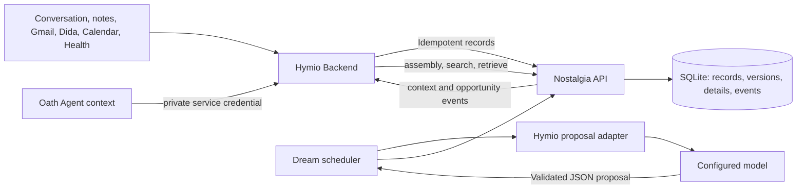
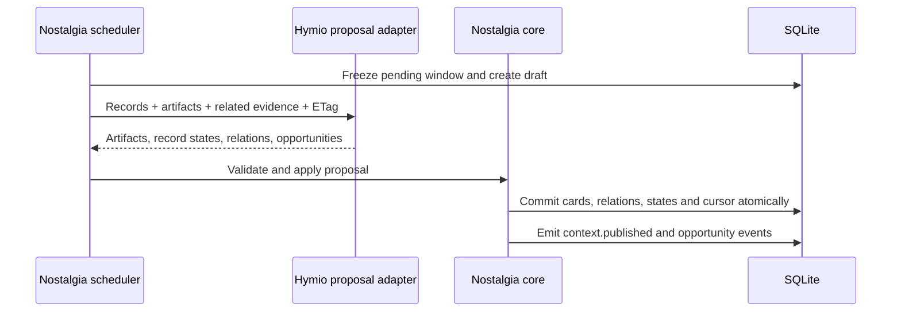

# Architecture and publication

Nostalgia is a small HTTP service with four explicit layers: authentication/API, versioned core
logic, protocol models and SQLite persistence. Hymio owns collection and product policy; Oath owns
execution. Nostalgia does not run the normal conversation Agent and does not contain a second task
scheduler.

## System context

The model-facing `remember` and `recall` commands live in Hymio. They call Hymio's authenticated
context proxy; the proxy resolves the owner's private Nostalgia endpoint and bearer token. Those
credentials never enter a prompt, a client or Oath.

## Request and service layers

| Layer | Responsibility |
| --- | --- |
| `api/` | FastAPI routes, bearer identity, body limits, JSON errors, service lifecycle and scheduler startup |
| `core/` | Record rules, draft/commit state machine, assembly, cursors, search and bounded graph reads |
| `protocol/` | Strict request/response models, IDs, source metadata, artifacts and relations |
| `storage/` | SQLite transactions, idempotency receipts, signed cursors and append-only context events |
| `dreaming.py` | Periodic bounded input selection, provider call, proposal application and failure events |

The service opens short transactions for both reads and writes. A model/provider call happens
outside a long database transaction.

## Data model

### Original records

Each accepted record contains:

- numeric `id` and stable `root_id`;
- `item_type` (`context` or `command`);
- a context type and JSON payload, or a command type/content/targets;
- optional `source` with kind, namespace, external ID, version, parser and strategy;
- produced time, service receive time, status and processing state;
- optional asset IDs and an idempotency signature.

The source namespace is not an authorization claim. It is routing and provenance metadata.
`namespace + external_id` identifies an external object for a user; a new external `version` becomes
a new immutable record under the same root. Conflicting content under an already-used version
returns a conflict instead of overwriting history.

### Versions and details

A version is Nostalgia's atomic publication boundary. It stores:

- an opaque version ID and state;
- the base publication;
- the processed cursor and the fixed input cutoff;
- a revision/ETag and a viewing token;
- retained-history and completion metadata.

Artifact cards, pending record states and typed relations are stored as version details. Starting a
dream copies the current version details into a draft. The active publication does not change until
commit validates the entire draft.

### Artifacts

An artifact includes content, type, topics, structured fields, original-record references and links
to other artifacts. Ordinary non-index artifacts must reference at least one original record inside
the dream cutoff.

Two special artifacts have product meaning:

| Artifact | Purpose |
| --- | --- |
| `_core` | Short overall understanding and essential grounded constraints. It can be placed in a stable model prefix. |
| `_index` | Specific-domain navigation summary with links to cards. It must be explicitly confirmed in every dream. |

`_index` must remain present. It may be empty only when there is genuinely nothing to summarize.

### Relations

Relations use record or artifact endpoints and one of `supports`, `supplements`, `contradicts`,
`supersedes`, `related` or `navigates`. They carry direction, status, origin, rationale and evidence
references. Legacy references become record → artifact `supports` edges; legacy links become
artifact → artifact `navigates` edges. A `related` edge is not evidence that two claims support each
other.

### Events

Record append, context publication and rollback write user-scoped `context_events` in the same
transaction as the state change. Delivery is at least once. Consumers persist their cursor only
after durable acceptance and deduplicate by event ID. Dreaming failure/completion and opportunity
events are also visible through the event and operations APIs.

## Dreaming and atomic publication

The scheduler wakes every configured interval, 600 seconds by default. It skips users with no
pending records or an active draft. A stale draft beyond its timeout is aborted. Input is bounded by
record count and serialized character size, and includes the latest existing cards plus related
evidence needed for review.

The proposal is untrusted data. Nostalgia applies record decisions first, artifact changes next,
and `_index` last, then runs full validation. Required checks include:

- every fixed-window input has a terminal process decision;
- references belong to the user and fall inside the dream cutoff;
- a deleted source is not still referenced;
- `_index` was explicitly confirmed;
- graph endpoints/evidence are valid and `supersedes` has no cycle;
- at most three opportunities are present and each cites original records from the frozen window.

Any failure aborts the draft. The active published state remains intact.

## Assembly and retrieval

`GET /v1/assembly` separates:

- `stable.content` and `cache_key`, derived only from `_core`;
- dynamic summary/injection data;
- a view token and the event feed URL.

Hymio's Oath context adapter currently places bounded `_core` content and the `_index` navigation
summary into the application context. The pending buffer remains available through injection and
exact-record reads; it is not silently promoted into a durable fact or a system instruction.

Agent retrieval follows a narrower path:

1. use the literal index/query to find candidates;
2. expand a bounded relation neighborhood when needed;
3. read exact records/artifacts;
4. keep source uncertainty, dates and truncation visible.

The graph query limits depth to two and the result to 60 nodes per page. Retrieval is bounded to 40
nodes. It reports `truncated`, hidden-neighbor counts and a snapshot that changes when the published
view changes.

## Sources and connector ingestion

Hymio initially reads Gmail, Dida, selected Apple calendars and daily Apple Health summaries. The
Backend stores encrypted provider credentials and normalized revisions, then projects each durable
change to Nostalgia with a stable operation identity and expected previous record.

Connector text is untrusted evidence. It cannot authorize tools, edit external services or prove
that a requested side effect happened. A connector namespace such as `gmail.<connection>` is also
not exposed as a user-facing memory taxonomy; the Memory UI derives source chips only from records
that actually exist.

## Recovery and retention

- A draft survives a process restart and can be continued until it commits or times out.
- A successful commit is idempotent; repeating it does not advance the cursor twice.
- Rollback restores the immediately previous retained publication and reopens later records for
  review. It does not delete the raw log.
- The default retention target is the current publication plus four predecessors. Old details may
  be pruned after that boundary.
- Uncertain writes use the original `Idempotency-Key`; uncertain events are replayed from the
  consumer's last accepted cursor.

See [HTTP contracts](./contracts) for concrete routes and [operations](./operations) for deployment.
