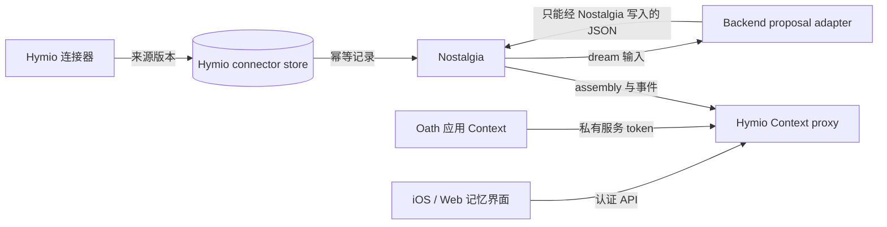

# 应用架构

Hymio 是模块化应用 monorepo，各运行时独立。客户端调用认证产品 API；Hymio 拥有产品状态与策略，
Oath 拥有任务 / Agent 执行，Nostalgia 拥有个人 Context 状态。

## 一次请求经过什么

<SystemArchitecture />

普通消息路径：

1. Web、Desktop 或 iOS 携带产品凭据与稳定 client identity；
2. Backend 验证账号、模型 / 窗口选择与附件所有权；
3. Oath 持久接纳输入，认领有界 step，构建请求并调用模型；
4. 工具调用经 Hymio 认证产品 API 返回；工具生命周期仍归 Oath；
5. 输出成为持久事件，每个客户端保存并确认自己的游标。

个人 Context 路径中，Hymio 在应用 Context 装配时向 Nostalgia 读取稳定 `_core` 与 `_index`。
Agent 可通过 `recall` 做有界搜索、关系扩展和精确依据读取。Context 只是数据，不授予工具权限。

## 客户端范围

| 客户端或代理 | 状态 | 边界 |
| --- | --- | --- |
| Web / Desktop | 当前 | 共享 React 前端、带标签侧栏、任务 inspector 与 A2UI renderer |
| iOS | 当前 | 原生 SwiftUI、三个一级入口、系统媒体 / 权限与 A2UI renderer |
| HymioDevice macOS | 当前 | 出站 WSS、截图 / 桌面 / 浏览器与显式开启的本机 Shell |
| HymioDevice Android | 当前执行适配器 | 屏幕共享、无障碍动作，不暴露 Bash |
| 浏览器扩展 | 脚手架 | 尚无 build manifest 或页面采集产品路径 |
| Apple Watch | 尚未交付 | 当前产品没有客户端实现 |
| Hymio Android App | 尚未交付 | Android 执行适配器不等于完整 Hymio 对话应用 |

客户端共享账号、对话、任务和记忆 API，但每个安装维护独立的 event cursor。关闭客户端不会撤销
服务端已接纳的工作。

## 仓库结构

| 目录 | 职责 |
| --- | --- |
| `apps/client` | React Web 与 Tauri Desktop |
| `apps/ios` | 原生 SwiftUI 客户端与平台能力 |
| `apps/admin` | 资源、监控、工具与 Nostalgia 运营管理台 |
| `apps/chrome` | 浏览器扩展责任脚手架 |
| `packages/client`、`packages/protocol` | 客户端传输、共享契约与事件处理 |
| `packages/ui`、`packages/a2ui` | 设计 tokens / 组件与受限 Hymio UI renderer |
| `backend/hymio_backend` | 身份、连接器、Context 代理、媒体、任务投影、设备与管理 API |
| `extensions/{skills,tools,cli}` | 通过 Oath 加载的 Hymio 能力 |
| `deploy` | 本机与单主机云端组合 |

旧的 `kits/` 与 `services/kit-host` 已不在当前源码树中。

## 状态所有权

| 状态 | 所有者 |
| --- | --- |
| 账号、session、连接器版本与加密 Provider 凭据 | Hymio Backend SQLite |
| 附件、生成媒体、通知投递与设备许可 | Hymio Backend |
| 个人 Context 原始记录、卡片、关系、事件与发布版本 | Nostalgia |
| Task、Run、TaskAgent、检查点、工具状态与 Agent Context | Oath |
| 客户端投递游标 | 每个已认证客户端安装 |

Hymio 不保留第二套任务业务状态，也不建第二套记忆数据库；它只代理并投影所有权服务的当前状态。

## 任务投影

Hymio 公共任务 API 有意保持有限：

- `GET /tasks` 列出当前已认证用户的任务；
- `POST /tasks` 读取一个任务，转发 `pause`、`resume`、`cancel`，或处理 `archive_list`、
  `archive_hide`；
- 创建任务和修改要求仍由 Agent 通过 Oath 工具完成。

Backend 把 Oath Task / Run 映射成稳定产品字段。界面展示时间范围、执行方式、当前阻塞、绑定 Agent、
Team 消息和 Workflow DAG 边。已结束 Task 离开活动列表；已完成与已取消记录通过归档单独返回，
不会被合并成同一种成功状态。

## Context 路径

Backend 从私有配置解析每用户 Nostalgia endpoint 与 token。浏览器、Oath 和模型都不会取得这些
凭据。Oath 从 Hymio 获得有界应用 Context；证据读取仍以 Nostalgia 为准。

## 连接器

Gmail、滴答清单、选定 Apple 日历和每日 Apple 健康摘要是彼此独立的只读来源。生命周期为：

1. 用户明确同意，完成 Provider / OS 授权；
2. 使用加密凭据和有租约的有限采集；
3. 原子更新本地来源版本与 checkpoint；
4. 带预期前序记录，以幂等操作投影到 Nostalgia；
5. 展示同步回执并独立重试。

远程文本是不可信证据。一封邮件或一条日历事件不能授权工具，也不能证明 Hymio 已修改外部系统。

## 执行设备

Web 与 iPhone 承载对话。个人 Mac 或 Android 通过出站 WebSocket 暴露原生能力；托管云电脑由
Provider 分配。同一显式 `device_id` 约束命令、截图与命令状态。

- Bash 优先选择在线个人 Mac，并明确报告 cloud fallback。
- Browser 与桌面操作保持在同一选定设备。
- 超时或断线可能留下未知副作用，不能盲目重放。
- Pause / resume / revoke 影响后续执行，不能撤销已经发生的动作。

## UI 与渲染

iOS / Web 收敛层已经采用 Material 3 色彩角色、色调表面、形状层级、导航几何与交互状态规范；
平台原生字体与图标是明确例外。

生成式 assistant UI 是另一套受限 A2UI 子集，只渲染卡片、文本、指标、选择、输入和会发送普通
消息的按钮。它不能执行任意 HTML、脚本、网络请求或隐藏工具调用。

## 扩展边界

产品校验留在 Backend。通过 Tool、CLI 或 Skill 暴露有界能力，并让私有凭据远离 prompt 和客户端
bundle。每次工具调用都必须带简短语义描述供探索过程展示；具体命令语法属于更深层的调试或运营
界面。

继续阅读[任务、Agent 与日历](./tasks)、[HTTP API](./api)、[UI/UX](./ui)与[进度页](../status)。
