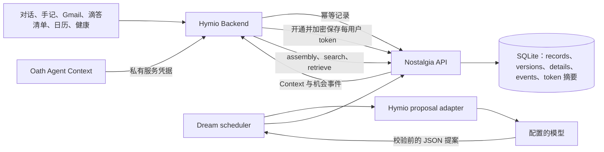
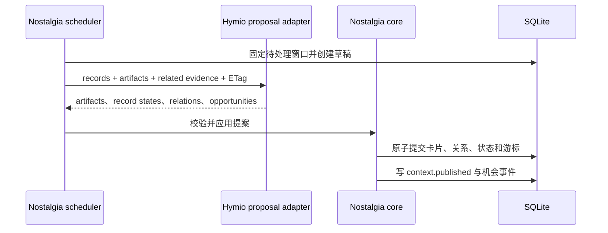

# 架构与发布

Nostalgia 是小型 HTTP 服务，明确分为认证 / API、版本化核心逻辑、协议模型和 SQLite 持久化四层。
Hymio 负责采集与产品策略，Oath 负责执行；Nostalgia 不运行普通对话 Agent，也不维护第二套任务
调度器。

## 系统关系

模型可见的 `remember` 和 `recall` 位于 Hymio。它们调用 Hymio 的认证 Context 代理；代理再按用户
解析自动开通的 Nostalgia endpoint 与 bearer token。Hymio 只保存加密 token，Nostalgia 只保存
token 摘要。凭据不进入 prompt、客户端或 Oath。

## 请求与服务分层

| 层 | 职责 |
| --- | --- |
| `api/` | FastAPI 路由、Bearer 身份、请求大小、JSON 错误、服务生命周期与调度启动 |
| `core/` | 记录规则、draft / commit 状态机、assembly、游标、搜索与有界图读取 |
| `protocol/` | 严格请求 / 响应模型、ID、来源元数据、artifact 与 relation |
| `storage/` | SQLite 事务、token 摘要、幂等回执、签名游标与追加式 Context 事件 |
| `dreaming.py` | 周期选择有界输入、调用 Provider、应用提案与写入失败事件 |

读写都使用短事务。模型 / Provider 调用发生在长数据库事务之外。

## 数据模型

### 原始记录

每条已接收记录包含：

- 数字 `id` 与稳定 `root_id`；
- `item_type`：`context` 或 `command`；
- context 类型与 JSON 内容，或 command 类型、内容与目标；
- 可选 `source`：kind、namespace、external ID、version、parser 与 strategy；
- 发生时间、服务接收时间、状态与处理状态；
- 可选 asset ID 与幂等签名。

source namespace 是路由和溯源信息，不是授权声明。`namespace + external_id` 标识某用户的外部
对象；新的外部 `version` 会在同一 root 下追加不可变记录。同一版本携带不同内容会返回冲突，不能
覆盖历史。

### 版本与详情

Version 是 Nostalgia 的原子发布边界，包含：

- 不透明 version ID 与状态；
- 基础发布版本；
- 已处理游标与固定输入截止位置；
- revision / ETag 和 viewing token；
- 保留历史与完成信息。

Artifact、尚未提交的 record 状态和显式 relation 存在 version details。开始 dream 时，当前生效
版本的 details 被复制到草稿；提交校验全部通过前，生效发布不变化。

### Artifacts

Artifact 包含正文、类型、主题、结构化字段、原始 record 引用和其他 artifact 链接。除索引外的
普通 artifact 至少需要引用一条 dream cutoff 内的原始记录。

两个特殊 artifact 具有产品语义：

| Artifact | 用途 |
| --- | --- |
| `_core` | 简短整体理解与真正重要的、有依据的长期约束，可进入稳定模型前缀 |
| `_index` | 面向具体领域的导航摘要与卡片链接；每轮必须显式确认 |

`_index` 不能删除。只有确实没有可总结内容时，才允许它是空索引。

### 关系

Relation 的端点只能是 record 或 artifact，类型为 `supports`、`supplements`、`contradicts`、
`supersedes`、`related` 或 `navigates`。关系记录方向、状态、来源、理由和证据引用。旧
references 投影为 record → artifact `supports`，旧 links 投影为 artifact → artifact
`navigates`。`related` 不表示两段内容互相证明。

### 事件

接收记录、发布 Context 和回滚都在状态变化的同一事务中写入用户隔离的 `context_events`。投递
至少一次。消费者只有在持久接纳后才保存游标，并按 event ID 去重。Dreaming 失败 / 完成与任务
机会也通过事件及运维 API 可见。

## Dreaming 与原子发布

调度器按配置周期唤醒，默认 600 秒；没有待处理记录或已有活动草稿时跳过。超过超时时间的旧草稿
会被放弃。输入受记录数量与序列化字符数限制，并包含本次复核所需的现有卡片和相关证据。

Proposal 是不可信数据。Nostalgia 先应用记录结论，再应用 artifact，最后处理 `_index`，随后做
完整校验。必须满足：

- 固定窗口内每条输入都有终态处理结论；
- 引用属于当前用户并落在 cutoff 内；
- 已删除来源不能继续被卡片引用；
- `_index` 已显式确认；
- 图端点 / 证据合法，`supersedes` 无环；
- 最多三个机会，且每项都引用固定窗口中的原始记录。

任何失败都会放弃草稿，当前已发布版本保持不变。

## 装配与检索

`GET /v1/assembly` 分离：

- 只由 `_core` 得到的 `stable.content` 与 `cache_key`；
- 动态摘要 / 注入数据；
- view token 与事件地址。

Hymio 的 Oath Context adapter 当前把有界 `_core` 和 `_index` 导航摘要加入应用 Context。近期
buffer 仍可通过 injection 与精确 record 读取获得；它不会被静默提升为稳定事实或系统指令。

Agent 检索路径是：

1. 通过字面索引或查询找到候选；
2. 必要时展开有界关系邻域；
3. 读取精确 record / artifact；
4. 保留来源不确定性、时间和截断信息。

Graph query 最多两跳、每页 60 个节点；retrieve 最多 40 个节点。响应明确给出 `truncated`、
隐藏邻居数量和快照；发布视图变化时旧快照会被拒绝。

## 来源与连接器写入

Hymio 首版读取 Gmail、滴答清单、用户选择的 Apple 日历和每日 Apple 健康摘要。Backend 保存加密
Provider 凭据与标准化版本，再以稳定操作身份和预期前序记录把每个持久变化投影到 Nostalgia。

连接器文本是不可信证据，不能授权工具、修改外部服务或证明某个副作用已完成。`gmail.<connection>`
等 namespace 也不会被当作内置记忆分类；Memory 界面只根据真实存在的记录生成来源标签。

## 恢复与保留

- 草稿能跨进程重启恢复，直到提交或超时。
- 提交是幂等的；重复提交不会再次推进游标。
- 回滚恢复上一份保留发布，并把之后的记录重新纳入审阅；原始日志不删除。
- 默认保留当前发布及前四份。超出边界的旧 details 可以被清理。
- 写入结果未知时复用原 `Idempotency-Key`；事件从消费者最后持久确认的游标重放。

具体路由见 [HTTP 契约](./contracts)，部署见[运维](./operations)。
