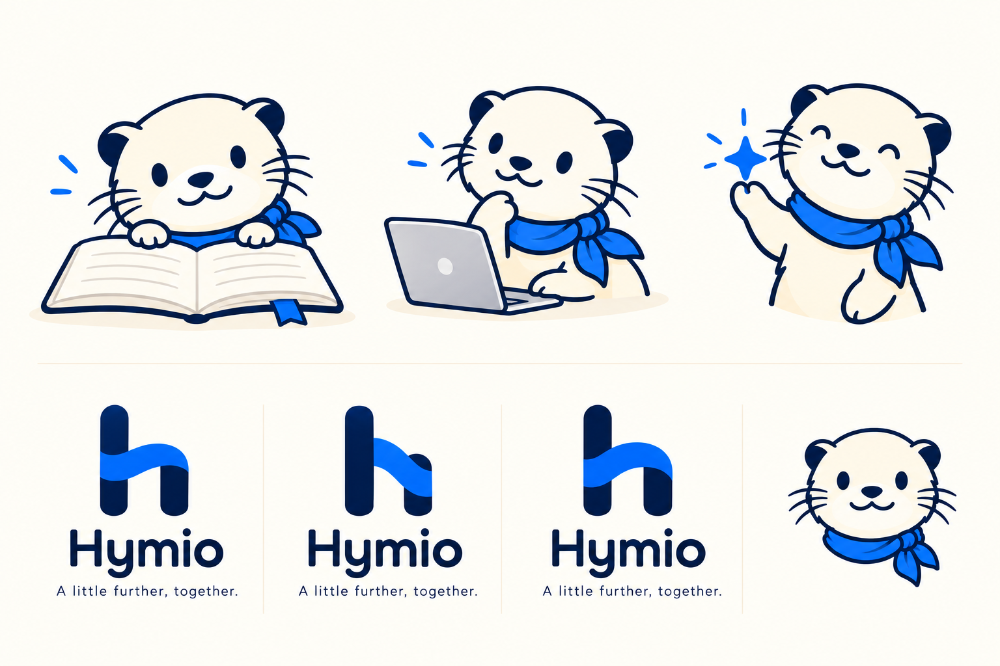

# 一个小写 h，一位熟悉的伙伴

**HymioSpace 是组织，Hymio Assistant 是产品角色。** 小写 **h** 代表组织，蓝围巾小水獭是吉祥物。两者可以共同出现，各自承担不同职责。

## 标志：连接，也保持独立

两个竖向结构，一道连接。桥的意象连接通信与执行，同时保留各自身份。克制的深蓝结构中，一笔明亮的蓝色带来温度。

上面的 Bridge、Night、Signal 是同一身份的设计探索，不是三个不同产品。导航继续使用当前组织标志，候选方案留待后续细化。

## 小水獭：有能力，好奇，也懂分寸

奶油色、清楚的深蓝线条、小耳朵与不对称蓝围巾，构成容易识别的角色。缩小时轮廓仍应清楚。围巾可以灵动，面部要安静、稳定。

让小水獭负责欢迎、回应与解释；状态仍用明确文字表达，不能仅靠表情区分失败或完成。

## 角色草图

这些插画为本次文档草稿生成，用于探索，不表示要替换全部现有应用资源。下一轮可以继续细化姿态，导出独立的正式素材。

## 语气

- **直接：**“比较结果准备好了。”
- **诚实：**“我还不能确认这个操作是否完成。”
- **有分寸：**“这一步需要你决定，我再继续。”
- **安静：** 有帮助时再说，不因为工具运行过就必须播报。

## 色彩与动态

深蓝、暖纸色，加上一点明确的蓝。动效对应有意义的变化：接纳工作、推进、重连。交互图由读者主动播放，可以暂停和逐步查看；系统减少动态效果设置会关闭视觉过渡。

品牌是逐步成长的共同语言，素材来源记录在仓库的 `ASSETS.md`。
